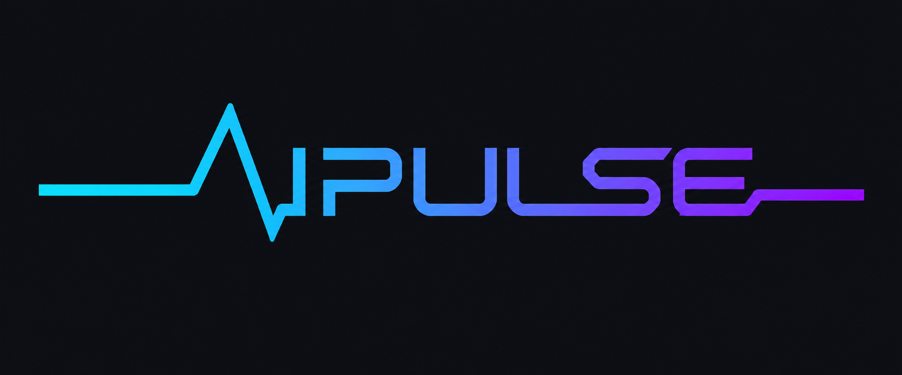
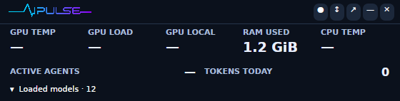
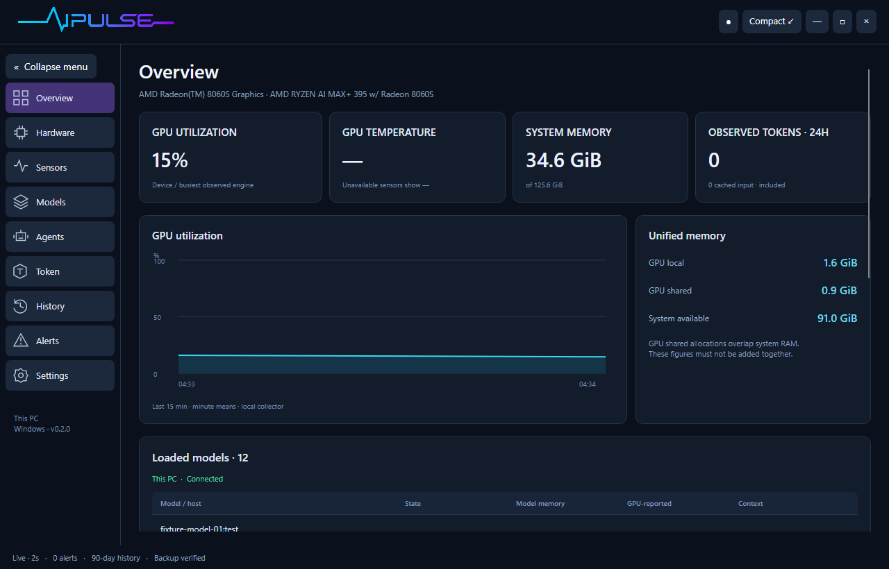

# AIPULSE

**Your hardware, local models and agent usage in one compact desktop dashboard.**

AI Pulse is a dark Windows and Ubuntu application for people running local AI. Pin it beside your work, see every loaded model, and expand it for sensors, token usage, history and backups.

> **0.2.1 preview:** Windows has been exercised on an AMD Ryzen AI Max+ 395 / Radeon 8060S machine with real Ollama requests. Linux packages use the same app and bundled runtime; consult the [validation report](docs/VALIDATION.md) for the exact testing boundary. Sensor availability varies by hardware and driver. This is monitoring software, not a thermal safety controller.





These are screenshots of the running app. See the [illustrated guide](docs/USER-GUIDE.md) for both widget orientations, model dropdown, collapsible sidebar and search.

Screenshots with `fixture-model-*` names use synthetic Ollama responses to demonstrate many-model layouts; they do not represent inference benchmarks.

## Download and install

Open **[Releases](https://github.com/nikhilgs817/AI_PULSE/releases)** and choose your platform:

- **Windows 11 x64:** `AI-Pulse-Setup-0.2.1-x64.exe`. Open the installer, install, then launch AI Pulse. A portable ZIP is also available.
- **Ubuntu Desktop x64:** `ai-pulse_0.2.1_amd64.deb`. Open using your desktop's package installer. If it has no local-package handler, see the [Ubuntu instructions](docs/INSTALLATION.md#ubuntu).
- **Linux portable:** `AI-Pulse-0.2.1-x86_64.AppImage`. It may require “Allow executing file as program” and a compatible desktop environment.

The app bundles its .NET runtime, interface and SQLite database engine. **You do not install Python, Docker, .NET or a database server to use it.** Ubuntu still relies on standard OS libraries, resolved by the package manager. The database is created automatically on first launch.

If this repository is private, release downloads require repository access. You can also share a downloaded installer directly; it contains no personal usage data.

Read the [step-by-step installation guide](docs/INSTALLATION.md), including sensor permissions and upgrade/uninstall behavior.

## What you can do

- **Keep only critical readings visible.** The 560 × 142 horizontal widget and 260 × 256 vertical widget have a loaded-model dropdown. Open it to see every model, host, state, memory and last observed decode rate; large lists scroll within a bounded panel.
- **Watch the machine.** GPU load and memory, CPU load, physical RAM, network transfer, disk capacity, process usage and exposed temperature/power/fan/clock sensors.
- **Compare capacity with live use.** Hardware shows CPU/GPU utilization, RAM/GPU memory used versus capacity, storage used/available and live network traffic. Sensors provides detailed temperatures, power, clocks, fans and access status.
- **Measure Ollama requests.** The optional local gateway observes input/output/cache tokens, decode tokens per second, request duration, streaming completion and errors.
- **Watch agent resources and sessions.** See local Codex, Claude and Ollama app CPU, summed working-set memory and child-process details. Import Codex/Claude Code token metadata without saving prompts or replies. App resources are shared across sessions.
- **Inspect the Token page.** Separate on-prem Ollama and tool usage, with exact counts by source/model, input/output/cache/reasoning splits, selectable history and CSV export. Incomplete observations and coverage gaps are explicit.
- **Review history.** Seven days of detailed readings and configurable 7–365-day summaries, usage records and CSV exports. The shipping default remains 90 days.
- **Protect the data.** Verified SQLite snapshots, seven daily restore points plus weekly snapshots covering the configured retention period (13 weeks by default; 53 for a year), and an in-app restore flow that preserves the previous database.
- **Connect remote Ollama servers.** Add named endpoints, including an Ollama service you later host on k3s. Full Kubernetes node/pod monitoring is a [planned extension](docs/K3S.md).

## First five minutes

1. Install and open AI Pulse. Hardware monitoring starts automatically.
2. Leave Ollama running at its default `http://127.0.0.1:11434`; loaded models appear automatically.
3. Click **Expand ↗**, then **Settings** to check connection coverage.
4. For exact Ollama request tokens, point a compatible client to **`http://127.0.0.1:11435`**. AI Pulse forwards to your existing Ollama server. Direct traffic to port 11434 is not counted.
5. If CPU temperatures are unavailable on Windows, follow [deep sensor setup](docs/INSTALLATION.md#deep-sensors-on-windows). Ordinary monitoring continues without elevation.
6. Use **↕ / ↔** to choose a compact orientation, **▾ Loaded models** to show models, and the pin control to keep it on top. Drag any non-interactive surface to move it. Sign-in startup is optional in Settings.

The app does not install model weights or change Ollama's existing server configuration.

## Understand the numbers

- **Loaded** means the runtime reports a resident model. **Generating** means the gateway currently observes a request. A direct request can be generating even while AI Pulse only knows the model is loaded.
- **GPU local / shared / system RAM** overlap on unified-memory hardware. Do not add them together.
- **GPU VR SoC** is a specifically named sensor, not a GPU-core temperature. When the latter is unavailable, the compact view can show the exposed SoC sensor under its exact label.
- **Last request tok/s** is completed-request decode speed, not an instantaneous throughput measurement.
- **Cached input** is already included in input totals; reasoning tokens are already included in output totals. Claude cache-write input is normalized into total input.
- **Unknown is not zero.** Missing sensors and unavailable request counts show a dash or an explicit availability message.
- **Tokens are not your subscription bill.** AI Pulse does not infer ChatGPT/Claude subscription limits or invoiced cost.

See the [user guide](docs/USER-GUIDE.md) and [metric definitions](docs/METRICS.md).

## Documentation

- [Installation, upgrades and removal](docs/INSTALLATION.md)
- [User guide with screenshots](docs/USER-GUIDE.md)
- [Metrics and coverage](docs/METRICS.md)
- [Backups, restore and data locations](docs/DATA-AND-BACKUPS.md)
- [Ollama integration and test procedure](docs/OLLAMA-TESTING.md)
- [Validation results and known limitations](docs/VALIDATION.md)
- [k3s expansion plan](docs/K3S.md)
- [Architecture and development](docs/DEVELOPMENT.md)
- [Third-party notices](THIRD-PARTY-NOTICES.md)
- [ECG logo and brand assets](docs/BRANDING.md)

## Build from source

Developers need the .NET 10 SDK. End users do not.

```powershell
./scripts/build.ps1 -Runtime win-x64
```

```bash
dotnet publish src/AiPulse/AiPulse.csproj -c Release -r linux-x64 --self-contained true -o build/linux-x64
python3 scripts/package_linux.py
```

Run the built-in data/privacy/backup tests:

```powershell
./build/win-x64/AiPulse.exe --self-test --data-dir ./build/self-test
```

Do not commit `data/`, `backups/`, credentials, personal settings or local session logs. See [development instructions](docs/DEVELOPMENT.md) for packaging and release checks.

## License and contributions

AI Pulse source is MIT licensed. Bundled dependencies retain their own licenses, including LibreHardwareMonitor's MPL 2.0 license. Please include OS, app version and hardware model in bug reports; avoid posting prompts, credentials or personal session files. The app's offline diagnostic mode exports hardware readings only.

