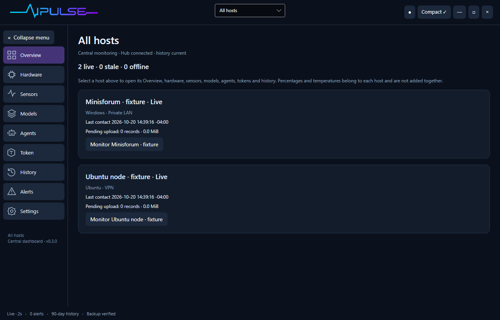
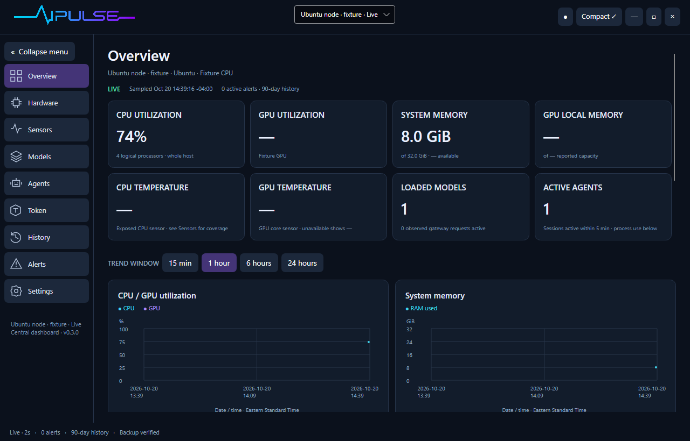
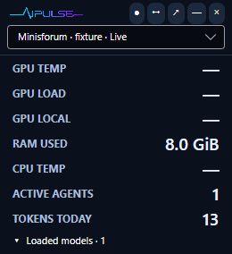

# Central monitoring — AIPULSE 0.3.0 preview

A single installer/runtime supports three roles: desktop dashboard, Hub service and Host Agent service. The dashboard selects **All hosts** or an individual host in both expanded and compact modes. A selected host scopes Overview, Hardware, Sensors, Models, Agents, Token, History and exports; Settings manages this desktop and fleet connection.







These screenshots use explicitly named synthetic Windows/Ubuntu hosts to verify identity isolation and the interface. They do not claim that a second physical computer has already been paired.

## Main computer

1. Install AIPULSE and open Settings → Central dashboard & Host Agents.
2. Enter the main computer's DNS name or private IP address and select **Set up this computer as the main hub**. Approve the normal operating-system administrator prompt.
3. Refresh service status and confirm the hub is running. The hub listens on HTTPS port 11440 by default. Windows installs a program-specific inbound rule for Private/Domain networks. Ubuntu firewall/router configuration remains under your control.
4. Save the displayed dashboard connection. This verifies the hub certificate and access token. Restart AIPULSE to enter central mode; the desktop stops its own collectors so the Host Agent owns collection.
5. The main computer also needs a Host Agent if you want to monitor it. Follow the next section, choosing this computer's name.

## Each monitored computer

1. On the hub dashboard, choose **Private LAN**, **VPN** or **Internet**, enter a host label and create a Host Agent pairing file.
2. Transfer that file privately to the target computer. It expires in ten minutes and can enroll only one installation. Verify the hub address and certificate fingerprint over a trusted channel.
3. Install/open the same AIPULSE package on the target. In Settings, import the pairing file and install its Host Agent. Optionally allow the two supported Codex/Claude Code metadata folders for the currently signed-in user.
4. Approve the operating-system service installation. The agent starts now and automatically at boot, without opening a dashboard or waiting for sign-in. Close the target's dashboard or configure it to use the hub to avoid duplicate standalone collection.
5. Select the host in the main dashboard. Other computer names, model names and session IDs can be identical; histories remain isolated by installation identity.

On Windows the services use separate protected binaries under Program Files and data under ProgramData\AIPULSE. On Ubuntu they use /usr/lib/aipulse-services and /var/lib/aipulse-hub or /var/lib/aipulse-agent. They cannot safely run privileged binaries from a user-writable project folder. Source, builds, documentation and dashboard data for the development installation remain under custom_apps.

## Offline operation and history

Agents continue hardware, process and model collection when the hub is unreachable. Local observations and their durable upload records commit in the same SQLite transaction. The hub acknowledges only committed records. Retries are deduplicated, including a lost acknowledgement. A separate latest-state request keeps fresh readings visible while older history uploads.

The pending payload budget is 2 GiB per agent. Exhaustion pauses durable collection with a storage-pressure state instead of silently discarding records; this is not a promise of unlimited offline storage. Local history/database/backups consume additional space. Central history defaults to 90 days and supports 7–365 days; raw samples, summaries and backups still consume disk according to sensor count. The hub delivery journal retains four hours (cleaned hourly); longer disconnections use an immutable, paged history snapshot followed by later journal events. Snapshot transfers expire after 24 hours, with at most two per host; completed and orphaned transfer copies are removed. Hub retention is set in its protected hub.json; remote Settings does not silently change a host's policy. The agent setup can include this computer’s existing retained minute history and usage. It takes a verified snapshot, seeds it once into the durable queue, and preserves the original standalone data. Fresh agent installations otherwise start central collection at installation. A migration must fit within the pending-payload budget; large datasets require an administrator migration plan. Opted-in supported tool files are imported for the retained interval.

Live, stale and offline states are separate from pending history. More than ten seconds without a fresh sample is stale; more than thirty seconds without an authenticated live update is offline. Cached history remains available while a hub is disconnected; current readings become unavailable rather than showing false idle values. Chart times use the dashboard's explicitly displayed timezone.

## Network profiles

- **Private LAN:** use a reachable LAN DNS name/IP and the hub's SHA-256 certificate fingerprint. No trust-store or Windows security-policy changes are needed.
- **VPN:** use the existing VPN address/DNS and the verified fingerprint. AIPULSE does not install a VPN; permit the hub port on that network as appropriate.
- **Internet:** use a reachable HTTPS hostname with a publicly trusted certificate. Replace the generated local certificate with the managed certificate before installing the hub, and configure DNS, routing/NAT and the required firewall rules. The client always verifies public trust and hostname in this mode; selecting Internet cannot make a private machine reachable by itself. The port is configurable in hub.json. A reverse proxy may terminate publicly trusted HTTPS in front of a secured hub connection; never expose a plaintext agent endpoint.

The agent opens outbound HTTPS connections; it exposes no network control listener. Its optional Ollama observation gateway remains loopback-only. Upload credentials cannot query other hosts or administer the hub. Pairing and telemetry APIs do not carry remote commands, prompts, replies or arbitrary files. The dashboard access token grants fleet administration and must be kept private.

## Services, upgrades and removal

Windows service names are AIPULSEHub and AIPULSEAgent. Ubuntu units are aipulse-hub and aipulse-agent. Both use automatic startup and restart policies. Settings shows local service status and provides stop/remove actions with administrator authorization; these preserve stored history, configuration and runtime files. Removing only the desktop package leaves these independent services running. Run setup again with the newer package to update service binaries while preserving identities and credentials.

For command-line administration (from an authorized elevated terminal), the same bundled executable supports:

```text
AiPulse --init-hub --data-dir <staging-folder> --hostname <hub-name>
AiPulse --install-fleet hub --source-config <staging-folder> --data-dir <installation-log-folder>
AiPulse --install-fleet agent --source-config <folder-containing-agent.json-and-settings.json> --data-dir <installation-log-folder>
AiPulse --remove-fleet hub --data-dir <installation-log-folder>
AiPulse --remove-fleet agent --data-dir <installation-log-folder>
```

Use AiPulse.exe on Windows. On Ubuntu the package command is ai-pulse. Runtime roles --hub and --agent run headlessly; no display server is required for them. Secrets/configuration files receive restricted permissions. The optional Ubuntu user metadata reader runs as the invoking non-root user when installed through sudo/pkexec; encrypted/unmounted homes and unreadable files remain coverage gaps. The Windows service reads configured metadata folders with the matching signed-in user's access token. It waits when that user is unavailable; hardware collection continues. It does not use its SYSTEM file permissions to read another user's logs. Prompts and replies remain outside the stored schema.

## Preview boundaries

This first fleet version targets small personal installations. Hardware and protected sensor coverage still depends on OS permissions and drivers. The existing interactive sensor helper is not remotely elevated by the hub. Source observations may overlap when a tool uses a monitored Ollama gateway; independent sections retain that distinction.

Per-user companion IPC, automatic hub-restore reconciliation, certificate rotation UI, fleet-wide alert editing, automatic remote upgrades and Kubernetes pod collectors remain later work. Hub data and protected enrollment configuration need coordinated administrator backups; do not restore one host database to an earlier point while agents continue acknowledging uploads. For this preview, a hub rollback requires an explicit recovery/re-enrollment procedure, not silent continuation. No supported large-fleet capacity is claimed.

See [architecture](FLEET-ARCHITECTURE.md), [protocol implementation](../src/AiPulse/FleetHub.cs) and [monitoring research](MONITORING-RESEARCH.md).
