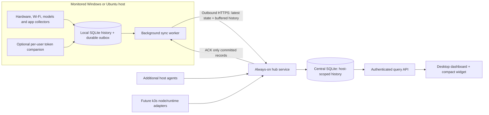

# Central dashboard and host-agent architecture

**Decision date:** 2026-10-20. **Architecture direction:** accepted from the owner's request. **Implementation status:** planned; the released 0.2.1 app remains a local collector. The Overview/network/chart work is the first UI increment, not a claim that remote agents already ship.

## User experience

Install **AIPULSE Hub + Dashboard** on the main computer. Install **AIPULSE Host Agent** on each monitored Windows or Ubuntu system. The hub can also run on an always-on machine, with the desktop dashboard connecting to it.

The dashboard header contains a searchable **Host** dropdown: **All hosts**, **This PC**, and paired remote hosts. Every entry shows connection and collection status. Selecting a host scopes Overview, Hardware, Sensors, Models, Agents, Token, History and Alerts to that identity. Compact mode shows the selected host's name and freshness; it never silently switches back to local readings. A separate name, **Host Agent**, distinguishes the monitoring service from Codex/Claude AI sessions.

Setup includes **Network type: Private LAN / VPN / Internet**. Each host has its own saved profile, hub URL and authentication. Switching a profile changes transport configuration, not host identity or history. No automatic switch to an untrusted endpoint is allowed.

- **Private LAN:** configure a reachable private hub address and verify the hub certificate fingerprint during pairing.
- **VPN:** configure the hub's VPN address/DNS name; the app uses the existing VPN rather than installing a VPN or opening agent ports.
- **Internet:** configure a reachable HTTPS hostname and a publicly trusted server certificate, normally on port 443. Router/NAT, DNS and TLS termination must be configured where the hub is hosted; choosing this option cannot create internet reachability by itself.

All profiles use HTTPS with verified hub identity and a separate credential per host. Agents initiate outbound connections. They expose no incoming remote-control port.

## Components and deployment

**Host Agent:** a headless .NET worker, installed as an automatic Windows Service or a boot-enabled systemd service. Sampling begins without interactive sign-in or network availability. The supervisor restarts failed workers. Sleeping/powered-off machines cannot collect; these periods are explicit gaps.

**Hub:** a separate service that receives, validates, persists, acknowledges and queries telemetry. It keeps running when the dashboard window closes. If the hub's computer sleeps or stops, agents buffer locally. An always-on hub is the recommended deployment for uninterrupted central availability.

**Dashboard:** the existing dark Avalonia app, consuming a common host-scoped query interface. It performs no duplicate hardware collection when the local Host Agent owns the collector. Standalone installations use the same interfaces with an embedded/local store.

**Per-user companion:** imports allowlisted Codex/Claude metadata with the consenting user's permissions and sends it to the local service through restricted IPC. Boot-time machine metrics are independent of this companion. A machine service must not assume its service-account home contains the interactive user's logs. Where permissions allow it, an explicitly configured profile reader may continue after logout; otherwise coverage says user metadata unavailable and resumes with backfill on sign-in.

**Deep hardware broker:** optional, isolated and local-only. Protected driver access stays outside the network-facing worker. The existing session-scoped sensor helper needs a deliberate service-aware IPC/permission redesign; moving its current code into a service does not automatically provide safe unattended sensor access.

## Store-and-forward behaviour

1. A local transaction stores the observation and its outbound record together. Network failure does not stop collection.
2. New live snapshots use a priority lane, while reliable history uploads in bounded batches. A long backlog must not hide current readings.
3. The hub authenticates the installation, validates schema/units/limits and commits a batch atomically. It returns explicit accepted record IDs **after** a durable commit.
4. The agent removes only acknowledged outbox records. Timeout or lost acknowledgement causes a retry, not guessed delivery.
5. Delivery is at least once; unique record keys and revision checks make retries have one effect on stored values and totals. The design does not claim exactly-once network delivery.
6. Retries use exponential backoff with jitter and bounded upload bandwidth. Live and history lanes have separate budgets so a reconnect storm does not exhaust the hub.

The protocol initially uses versioned HTTPS JSON batches, compression and bounded sizes: proposed limits are 1,000 records / 1 MiB decompressed per batch. Clients honour retry hints. Later transport changes must preserve record identity and acknowledgement semantics.

Latest-state messages expire; replaying yesterday's sample cannot make a disconnected host look live. History uses original observation time, while the hub also records receipt time. Boot ID, process start time and a persistent revision/sequence distinguish restarts, counter resets and out-of-order records. Clock skew is surfaced; live-age decisions also use authenticated receipt/heartbeat times.

### Retention and disk limits

- Central history retains the existing 90-day default, configurable through 365 days; detailed raw samples retain seven days, with minute summaries beyond that.
- Agents keep a durable local outbox, initially budgeted at 2 GiB per host with a visible queue age/size. This is a storage budget, not a promise of a fixed number of offline days.
- Under pressure, raw hardware history can be compacted into minute summaries with count/min/max/mean and an explicit resolution-change marker. Token/session observations receive a reserved budget and are not silently discarded.
- Queue exhaustion or disk-full marks the collector unhealthy and reports dropped/paused durable collection. The UI shows affected periods and counts. Storage cannot grow without bound or promise lossless recording on a full disk.
- Final capacity defaults require measured disk/bandwidth tests with the actual sensor count. A hub initially targets a small personal fleet; a supported host limit is published only after load testing.

The outbox and hub ingestion ledger use durable SQLite commits for acknowledged data. One serialized hub writer handles short transactions; SQLite files stay on local storage, not a shared network filesystem. Online, verified backups cover history; authentication secrets require a separate recovery/pairing process. A hub database restore creates a new hub epoch and forces reconciliation: local data retained by agents is re-offered, and irrecoverable gaps are reported rather than hidden by stale acknowledgements.

## Data identity and aggregation

Every record is scoped by `hub_id`, `host_id`, `installation_id`, `stream_id`, `record_id`, `schema_version`, `observed_at_utc`, `boot_id` and `revision`. Host names are editable labels; they are never database keys. Reinstall/clone detection requires re-pairing when installation credentials or identity no longer match.

The central schema separates hosts, capabilities, live snapshots, raw metrics, minute rollups, model residency, app resources, token observations, sessions, alerts, ingest receipts and per-host sync status. Child entities include stable device/interface/runtime identifiers. All reads, exports, alerts and retention jobs require an explicit host scope.

Agent-computed minute rollups are authoritative snapshots with deterministic bucket IDs and revisions. The hub replaces an older rollup revision; it never adds retransmitted totals or combines raw-derived and source-computed statistics twice. Usage/session updates likewise apply only newer revisions. Counter decreases after boot/interface reset establish a new baseline, never a negative traffic rate.

**All hosts** is a fleet summary, with a comparison row per host, online/stale/offline counts, alert severity, available capacities and independent token-source totals. CPU/GPU percentages and temperatures are compared per host/device rather than summed. RAM used/total may be summed across fresh, disjoint hosts; unified GPU memory is never added again. Missing/offline hosts are labelled and excluded from a current-capacity subtotal with the count shown.

Token observations retain host, source, user-profile scope and source record identity. Imported copies, tool-to-Ollama overlap and multi-hop gateways can describe the same work. Exact cross-host deduplication requires a shared request/event identity; where absent, the UI labels the totals as observations and keeps sources separate.

## Connectivity and health

Host states include **Pairing**, **Live**, **Connected / history syncing**, **Stale**, **Offline**, **Permission needed**, **Storage pressure**, **Revoked** and **Incompatible version**. Transport connectivity, collector health and data freshness are separate fields.

Proposed defaults: sample critical hardware every two seconds, app process resources about six seconds, model discovery four seconds, live push every two seconds and heartbeat every ten seconds. These are budgets with visible timestamps, not real-time guarantees. More than ten seconds without a fresh critical snapshot is stale; more than thirty seconds without a heartbeat is offline. A connected host with a failed collector remains connected but unhealthy.

The hub observes itself: ingest errors/latency, accepted/retried/duplicate counts, queue depth/oldest record, sync lag, database size/free space, backup age, collector failures and agent version. Alerts include the affected host and link to the relevant section/time window.

## Pairing and administration

Pairing uses a short-lived single-use code generated by an authenticated hub administrator and a verified TLS endpoint. A successful enrollment issues a high-entropy credential bound to exactly one host; the hub stores a verifier rather than plaintext bearer secrets. Credentials can be rotated/revoked per host. Agent credentials may upload only their own host's allowlisted telemetry and do not grant dashboard administration.

Secrets use OS-protected storage or service-account-only files, with restricted ACLs/permissions. Read/query/admin access is distinct from ingestion access. The protocol carries no remote shell, arbitrary file reader, prompts, replies, tool arguments, Wi-Fi passwords or Wi-Fi SSIDs/BSSIDs. Installing services and driver support requires the owner's normal OS authorization; selecting a network type never weakens TLS checks.

## Rich Overview and Wi-Fi design

The selected-host Overview answers: **Is the host healthy? What is consuming it? Is AI work progressing? Can I trust these readings?**

The top area shows host identity, OS, last collection time, alerts and retention/backup status. Metric groups cover CPU/GPU load, CPU/GPU temperature, used/total/available RAM, GPU local/shared allocations, loaded/generating models, active sessions and today's independent on-prem/tool tokens. Named source/capability status explains unavailable values.

Below, matched time windows show CPU/GPU utilization, memory pressure, temperatures and Wi-Fi traffic. Each chart has a title, units, dated time ticks, visible timezone, legend and explicit aggregation. Gaps remain gaps. Date/time persists when switching to multi-day history. Hover/selection inspection and range presets are staged chart improvements.

Wi-Fi distinguishes **actual download/upload throughput** from **negotiated adapter link speed**. It uses one selected interface, excludes filter-driver duplicates, resets rate baselines on reconnect and identifies the interface on the chart. Internet throughput benchmarking, gateway latency/loss, signal quality, radio band/channel and asymmetric TX/RX link rates are separate capabilities requiring dedicated providers or explicit test traffic; they must not be inferred from ordinary byte counters.

Models and app resource tables, storage pressure, active alerts and latest request outcomes provide drill-down links to their detailed tabs. **All hosts** replaces per-machine detail with fleet comparison and the worst affected hosts; individual device charts remain one click away.

## Implementation sequence and release gates

1. **Overview / chart increment:** richer local Overview, actual Wi-Fi traffic and link speed, dated/timezone axes, honest missing-data states, Windows/Ubuntu UI and unit checks.
2. **Shared core and local service:** extract contracts, collectors and storage from Avalonia; implement Windows/systemd lifecycle and the per-user companion. Verify boot before sign-in, logout, service restart and one collector per host.
3. **Hub and durable sync:** add authenticated pairing, host identity, host-scoped schema, ingestion/outbox and reconciliation. Verify disconnect/reconnect, lost ACK, retries, out-of-order revisions, clock skew, queue pressure, restore and credential revocation.
4. **Fleet dashboard:** host dropdown in both modes, All hosts view, scoped histories/tokens/alerts, live versus backfill status. Verify two hosts with identical model/session/device names cannot contaminate each other's records.
5. **Packaging and network profiles:** role-selecting Windows installer, agent-only Windows package and Ubuntu service packages, private/VPN/internet setup checks. Test clean boot, upgrade preserving identities/history, uninstall preserving optional data and bounded resource overhead.
6. **k3s adapter:** node Host Agent/DaemonSet first; pod/container/runtime metrics through separate read-only adapters. Hardware permissions and model token instrumentation remain explicit deployment choices.

The existing local database is backed up and imported under a stable **This PC** host identity. A controlled collector handover prevents the old UI and new service from collecting/importing the same records concurrently. Migration must preserve original observation IDs and timestamps, verify counts/totals and retain a rollback snapshot. Fleet capability is released only after the service/sync/security tests above pass on both operating systems.

## Implementation references

- [.NET Worker Services](https://learn.microsoft.com/en-us/dotnet/core/extensions/workers) and [Windows Service integration](https://learn.microsoft.com/en-us/dotnet/core/extensions/windows-service): supervised background host.
- [systemd service lifecycle](https://www.freedesktop.org/software/systemd/man/latest/systemd.service.html): boot/start/recovery semantics on Ubuntu.
- [SQLite WAL](https://www.sqlite.org/wal.html): local database concurrency and commit-durability considerations.
- [Monitoring research and UI decisions](MONITORING-RESEARCH.md): the observability product documentation informing this design.
