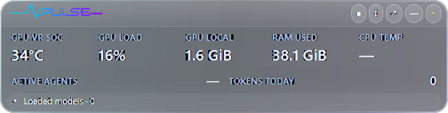
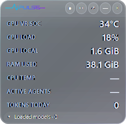

# Compact glass update · 0.3.1

The compact dashboard now has a Liquid Glass inspired surface: a restrained transparent smoke tint, curved reflective edges, an inner highlight and pill-shaped controls. It prefers native desktop blur where available, then clear transparency, rather than forcing heavily tinted acrylic. Header buttons, the optional fleet host selector and loaded-model cards use translucent fills. The hardware values and labels remain opaque and bold.

This is a cross-platform interpretation of the visual style, not Apple's native material or an implementation of its optical refraction. Compositor-provided blur or transparency and simulated reflection highlights provide depth without capturing the desktop into application memory or running an animated effect loop. In clear transparency mode the desktop behind the widget remains sharp rather than blurred.

Both 560 × 142 horizontal and 260 × 256 vertical layouts retain their dimensions, pinning, surface dragging, daily activity and expandable model list. Fleet mode retains the extra host-selector row. Glass overlays do not intercept pointer input. Expanding restores the solid dark dashboard and its maximize/restore controls.

These are control-rendered UI captures. Their transparent pixels inherit the page background; native desktop transparency depends on the desktop behind the installed app. Counts and readings are isolated test observations.

The same implementation ships on Windows and Ubuntu. The operating system decides which transparency level is available. When neither blur nor transparency is supported, including on Linux desktops without a compatible compositor, AIPULSE uses a dark opaque backdrop beneath the tint. No screenshot capture, third-party blur dependency, model download or new network destination is involved in this visual effect.

This is a focused visual update. The optional assistant and other unfinished integrations are outside this build. Windows packages remain unsigned until the separate SignPath setup is completed.

## Validation

The UI checks verify native-blur requests, a transparent compact window background, a dark fallback, passive visual overlays and restoration of the opaque expanded window. Existing interaction checks cover orientation changes, model-list scrolling, maximize/restore, navigation and host selection. Native desktop blur must also be inspected on a real desktop; a control-rendered test image alone cannot prove compositor behavior.

Windows local validation passed 36 data checks and 51 UI interaction checks, including fleet host selection. The desktop reported `Transparent` for the final clear-glass material; a native preview was also inspected. The earlier acrylic prototype was replaced after visual feedback. The [UI results](validation/glass-windows-ui.txt) record this boundary. Linux CI and local installation are verified separately. Data and backup folders are kept outside the application installation and are preserved during upgrades.

The local 0.3.1 installer completed successfully using application source `c8c36256d616ec4d838fc75255aec395c530ea24`. Its installed DLL hash matched the packaged build, and all 36 installed data checks passed. The existing database passed SQLite integrity validation with no decrease in retained usage, hardware samples, summaries or sessions. Live readings, including CPU temperature after the user approved the sensor helper, resumed. A verified pre-upgrade database and application backup were kept outside Git.

The [cross-platform build](https://github.com/nikhilgs817/AI_PULSE/actions/runs/41390620366) validates the same source on Windows and Ubuntu. Native Liquid Glass-style rendering was inspected on Windows; the Linux checks exercise the compositor fallback in a virtual desktop, rather than claiming validation of every Ubuntu compositor.

Implementation follows [Avalonia's window transparency guidance](https://docs.avaloniaui.net/docs/how-to/window-how-to#window-transparency).
