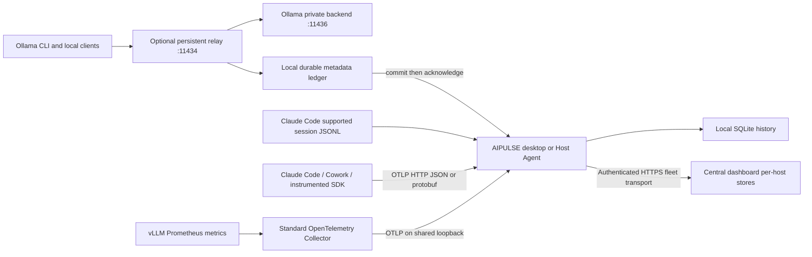

# Token collection framework (0.3.5 preview)

AIPULSE measures provider-reported usage at an instrumented boundary. It does not infer tokens from GPU load, model residency, RAM, a process being open, subscription percentages or a guessed tokenizer. Previous Ollama calls that bypassed capture cannot be reconstructed from `/api/ps`.

## Collection paths

- **Ollama request records:** native generate/chat/embed, OpenAI-compatible chat/completions/embeddings/Responses, and Anthropic-compatible messages when the installed Ollama version supports them. Final native streaming chunks and OpenAI SSE usage are parsed incrementally. Streaming OpenAI chat/completions requests explicitly request `include_usage`. Embedding input counts are supported where Ollama returns them. Older endpoints that omit counts remain incomplete.
- **Persistent capture:** opt-in relay owns the ordinary port, starts an installed Ollama backend with a process-scoped private port, forwards management APIs and writes only usage metadata. Requests do not depend on a visible dashboard. The dashboard imports the journal idempotently, commits before ACK and resumes after either process restarts. Windows setup starts at user sign-in; this is not a machine service or a claim of collection before sign-in. The boot-time Host Agent remains the option for unattended host collection. Private-backend calls bypass capture.
- **Claude Code:** supported local assistant-message usage records, configured `CLAUDE_CONFIG_DIR`, default and XDG roots, plus native `claude_code.api_request` logs and `claude_code.llm_request` spans. Stable request identity reconciles logs, spans and files. Cache reads/writes are input subsets; nested cache-write fallback and separately reported advisor iterations are handled. Plain message iterations are not counted twice.
- **Claude Desktop Code:** local, SSH and cloud sessions have different configuration sources. A terminal wrapper does not configure an already-running Desktop session. See the setup guide; use managed telemetry for the actual execution environment or readable session metadata when present.
- **Cowork:** accepts the official `cowork` service's `api_request` events. Stable request IDs are preferred; otherwise session/event sequence/time identifies the event. Official Cowork export requires Team/Enterprise administration. A personal subscription's cloud Cowork history is not a supported local token ledger.
- **Codex:** existing supported local cumulative `event_msg/token_count` records remain available. They use reset-aware deltas and stable replay IDs. Native per-response `token_usage_record` records are not added alongside cumulative events, because that would count the same usage twice. Native-only formats need an adapter; running Codex itself is not proof of supported telemetry.
- **vLLM, K3s and Kubernetes:** supplied Collector profiles scrape token counters, preserve instance/pod identity and engine labels, and export OTLP. Input, output, cached input and prompt-source breakdowns are supported where that vLLM version exposes them. This is token monitoring infrastructure, not a claim that full cluster inventory, GPU exporters or every vLLM latency histogram is implemented.
- **Other instrumented applications:** standard GenAI usage spans, inclusive input/output and cache subsets. Use an SDK, OpenLIT, LiteLLM or a compatible exporter; uninstrumented HTTPS calls cannot be observed by a desktop process. OTLP/gRPC clients can use an external Collector to translate to the embedded OTLP/HTTP receiver.

## Accounting rules

The Token page separates Ollama request records, tool observations, instrumented applications, and server/tool counters. A tool and its server may describe the same work. These boundaries are displayed independently; compare them rather than adding them. Instrumented application spans are excluded from the primary request summary. The compact counters also exclude those overlapping span observations. Neither view is an invoice or a subscription quota meter.

Claude input is normalized as uncached input + cache read + cache write. GenAI inclusive input already includes cache subsets. Reasoning is a subset of output, never an extra charge added to total. Missing observations display `—`; incomplete records and source coverage are explicit.

Cumulative metric streams establish a baseline on first receipt. Subsequent differences are keyed by metric, model, instance/pod UID, engine and allowlisted dimensions. Counter decreases and changed start times establish a new baseline. Duplicate/old samples are rejected. Delta metrics require non-overlapping intervals. Nanosecond timestamps distinguish exports inside one second. Native request records and metric counters are never summed together.

Calendar Today starts at the host viewer's local midnight; Last 24 hours is a rolling interval. Counters include only complete observation intervals wholly inside the selected period, so a cross-midnight interval is not arbitrarily assigned to today. Restarts between scrapes and exporter outages can leave gaps; baseline semantics intentionally avoid inventing the missing usage.

## Reliability and privacy

SQLite remains integrated in the self-contained build. The native SQLite dependency is updated to 3.53.3, which includes the upstream WAL-reset race fix. This is preventive hardening, not an established explanation for every earlier live-file inconsistency. A startup integrity check fails visibly and preserves original files; diagnostics record per-query failure classifications, effective storage location and native engine version. No automatic destructive repair occurs.

The embedded receiver binds only to IPv4 loopback (default 4319), rejects browser Origin requests, supports bounded gzip/JSON/protobuf input, and acknowledges successful exports only after synchronous database commits. Only allowlisted numerical usage, model, request/session identity and instance metadata are retained. Prompt/response text, user emails, connected paths, tool arguments, raw log bodies, cookies and credentials are discarded. Disable content capture at the source too.

The relay stores a local read key outside Git. Its metadata endpoint requires that key; it is not a network administration API. Keep the working stores on local storage. Existing bounded compressed backups and 90-day default / 365-day optional history remain in effect. Relay retained history is local; its pending journal is bounded at 256 MiB. Exporter in-memory queues are not durable across a Collector restart; add the Collector `file_storage` extension on a persistent volume for stronger outage guarantees.

Upgrade all fleet roles together for the new accounting event types. Fleet baseline snapshots include source health and counter intervals, and replay remains host-scoped. An older hub cannot understand the new records. A selected remote host's observation periods and instance labels are retained; cloud exporters need a reachable, authenticated TLS Collector and a local host-agent forwarding path, not an exposed anonymous desktop port.

## Evidence and scope of validation

Local automated tests cover native/SSE byte splits, OpenAI streaming usage requests, gateway health routing, management passthrough, Claude JSONL/log/span deduplication, cache arithmetic, OTLP protobuf/hex-ID JSON, browser rejection, counter baselines/resets/replay/interval boundaries, fleet replay and prompt non-persistence. A separate process test closes/restarts the relay and proves later import/ACK occurs once. A real OpenTelemetry Collector Contrib 0.165.0 test scrapes a synthetic vLLM endpoint and delivers protobuf counters to the actual app. Both supplied Collector configurations pass that binary's validation command.

Those checks do not constitute a live Kubernetes/vLLM deployment test or proof that a particular Claude account has enabled export. A real cluster and eligible account setup are required for those checks. Live Ollama validation is reported separately, using installed models only.

## Primary source and code review

Reviewed 8 November 2026. This implementation uses the standard protocols and independently written adapters; it does not vendor the monitoring applications below.

- [Ollama usage contract](https://docs.ollama.com/api/usage) and [compatibility](https://docs.ollama.com/api/openai-compatibility); inspected [API types](https://github.com/ollama/ollama/blob/d63b702609c4300a2ca07be2bdb0adb9834725e5/api/types.go) and server routing at that revision. Capture the provider's final usage rather than infer counts from residency.
- [Claude Code telemetry](https://code.claude.com/docs/en/monitoring-usage), [Desktop session policy scope](https://code.claude.com/docs/en/desktop#managed-settings), and [Cowork event schema](https://claude.com/docs/cowork/monitoring). Code and Cowork need separate setup; request IDs and sequence metadata provide replay identity.
- [ccusage Claude loader](https://github.com/ccusage/ccusage/blob/208516a682c983854fa7311ac59b9f2481fb88c8/rust/adapters/claude/src/lib.rs) and [root discovery](https://github.com/ccusage/ccusage/blob/208516a682c983854fa7311ac59b9f2481fb88c8/rust/adapters/claude/src/paths.rs). Source review informed discovery, replay handling and advisor/cache normalization. AIPULSE does not claim ccusage's full sidechain reconciliation or billing coverage.
- [OpenLIT Ollama instrumentation](https://github.com/openlit/openlit/blob/1b8a274d3b0d3ac85e00ebb07cde880ac95b4385/sdk/python/src/openlit/instrumentation/ollama/ollama.py) and its `utils.py`: instrumentation belongs around the client request. Its pinned cache assumptions differ from the latest Ollama fields; provider-version contracts take precedence.
- [LiteLLM OpenTelemetry integration](https://github.com/BerriAI/litellm/blob/cfddaafe189ffe8a79aa54b733e4def162659330/litellm/integrations/opentelemetry.py): standard traces are the interoperability boundary; avoid storing request content.
- [vLLM metric implementation](https://github.com/vllm-project/vllm/blob/83630ab85eb27e456d99008cc0a27e025e73c0b4/vllm/v1/metrics/loggers.py) and [`PromptTokenStats`](https://github.com/vllm-project/vllm/blob/83630ab85eb27e456d99008cc0a27e025e73c0b4/vllm/v1/metrics/stats.py): preserve model/engine series; total input, cache hits and locally computed work have different meanings.
- [OpenTelemetry Prometheus receiver](https://github.com/open-telemetry/opentelemetry-collector-contrib/blob/v0.165.0/receiver/prometheusreceiver/README.md) and [resource mappings](https://github.com/open-telemetry/opentelemetry-collector-contrib/blob/v0.165.0/receiver/prometheusreceiver/resource_attribute_mapping.md): reuse discovery/translation rather than build a private Prometheus parser.
- Official [OTLP definitions](https://github.com/open-telemetry/opentelemetry-proto/tree/169f2f2c7c1550c364d5eecb05d1b6163a011b06), pinned unmodified under `src/AiPulse/Telemetry/Proto` with license and hash manifest; C# generated at build time.
- [SQLite corruption guidance](https://www.sqlite.org/howtocorrupt.html) and [recovery limits](https://www.sqlite.org/recovery.html). Live file copies are forensic artifacts, not verified backups; salvage output is not automatically returned to service.
