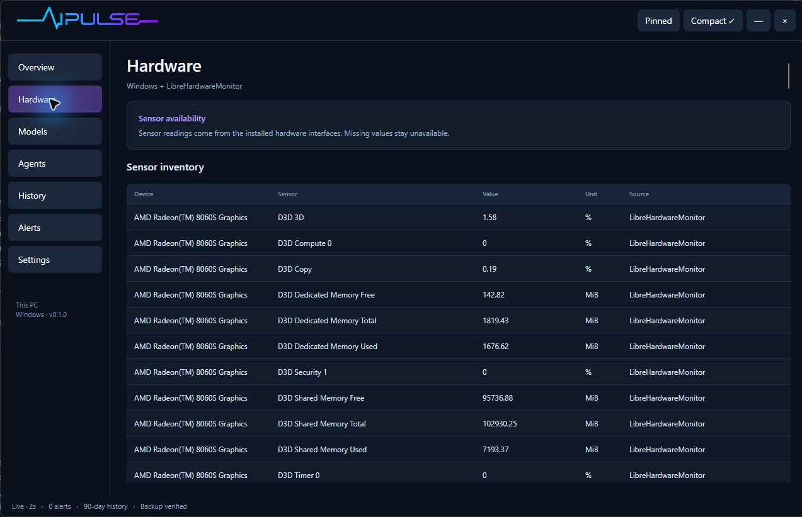

# Using AI Pulse

## Compact mode

The fixed top strip shows GPU temperature when exposed (otherwise an explicitly labeled GPU VR SoC sensor when available), GPU utilization, local GPU allocation, physical memory used and CPU temperature. A dash means no reliable reading.

Every resident model has a row. The row includes host, state, model-reported memory and last observed decode speed. The list scrolls when it exceeds the available height. Drag the title area to position the window, resize the edges, and use **Pin/Pinned** to toggle always-on-top. The monitor position is saved when switching modes or closing to tray.

**Expand ↗** or **Ctrl+D** opens the full dashboard. Click a model row to open Models. **Compact ↙** returns to the widget. On Windows the close button hides to the tray while collection continues. On Linux the close button exits, so a missing tray cannot leave an inaccessible window. Use **Ctrl+Q**, Settings **Quit AI Pulse**, or the tray **Quit AI Pulse** action to stop collection.

Loaded models are not the same as active sessions. Codex/Claude rows below the model list show recent supported agent usage. Multiple agents can use the same loaded model without duplicating that model's memory row.

## Overview

The headline cards show GPU load, GPU core temperature availability, system memory and observed tokens in the last 24 hours. The GPU chart plots minute-average samples. Unified-memory figures remain separate because they overlap. The connection panel explains token coverage.

## Hardware

Browse each exposed sensor with device, value, unit and source. This includes per-core load, clocks, temperatures, powers, fans and storage readings when supported. Top processes show CPU as a percentage of total host capacity and working-set memory. Working sets can overlap shared pages and should not be summed as exact physical usage.

A sensor library can provide more readings after deep access is enabled. GPU and CPU temperatures are not interchangeable. The app rejects invalid zero/out-of-range temperature readings rather than displaying them as healthy.

## Models

The loaded list comes from each Ollama endpoint's runtime state. The installed inventory lists model tags, quantization and on-disk model sizes. Aliases can refer to shared blobs; adding all listed sizes does not produce physical disk consumption.

Recent observed requests display input/output counts, decode rate, elapsed duration and outcome. Only gateway traffic is included. Direct Ollama clients, including clients that cannot change their server URL, may be visible as loaded models without request counts.

## Agents

Supported local Codex and Claude Code session records supply model identity, token categories and last activity. This importer follows source formats and may need updates when those tools change. It reads metadata; it does not persist conversation contents. Claude Desktop Chat/Cowork coverage is not implied by Claude Code support.

“Working” is based on an observed Codex lifecycle event. “Recent activity” is weaker evidence. After inactivity, unresolved sessions show **Quiet / unknown**. A running process is not proof that an agent is generating.

## History and alerts

Choose 1, 7, 30 or 90 days. History retains raw samples for seven days and minute aggregates/request records for 90 days. Historical charts show means; stored min/max values preserve peaks. The first run cannot reconstruct hardware data from before installation.

**Export usage CSV** writes the full retained 90-day usage metadata into the exports folder, without the recent-request table's 20,000-row query cap. Text fields that spreadsheet programs could interpret as formulas are escaped. Headline totals query the full selected period.

Alerts cover sustained temperature thresholds, memory pressure, low data-drive space and failed backups. The default temperature warning is a user-configurable informational threshold, not a manufacturer safety limit. Alerts are displayed in the dashboard; native OS toast delivery is not implemented in this preview. No alert shuts down workloads or changes fan speeds.

## Settings

- **Local Ollama server:** upstream target, normally port 11434.
- **Remote endpoints:** one `Name | URL` per line, with unique names. This currently discovers remote Ollama models, not their host sensors or Kubernetes pod metrics.
- **Read local usage metadata:** enables/disables future local log ingestion; existing retained records remain until retention/removal.
- **Launch at sign-in:** registers a per-user startup entry. It does not create a privileged service.
- **Temperature warning:** threshold sustained for 30 seconds.
- **Back up now / Restore:** create a verified snapshot or choose one to restore. Restore restarts the app after confirmation and retains the old database.

Remote endpoints should be on a private network or protected transport. URLs with embedded credentials are rejected. This preview does not yet provide credential-managed remote connections.

## Troubleshooting

- **No models:** check Ollama is running and that a model is actually loaded, not just installed.
- **Tokens missing:** verify the client uses port 11435; restart AI Pulse if the gateway reports its port is occupied. Never assume a model's tokens are known from GPU usage.
- **CPU temperature missing:** follow the deep sensor instructions. Sensors still unavailable after that may be unsupported.
- **Stale readings:** the collector has stopped producing fresh samples. Restart the app and inspect the diagnostic/log files.
- **No new history while asleep:** collection cannot run when the computer is asleep/off. Gaps are expected; backups catch up after resume.
- **App already running:** open the shortcut again to bring its existing window forward, or use the tray Open action. One process per data directory prevents concurrent collectors from duplicating history.
- **Model traffic fails after closing AI Pulse:** clients configured to use its gateway need AI Pulse running. Change the client back to the direct Ollama endpoint for rollback.
