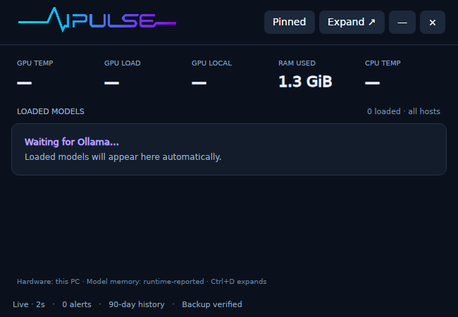

# Validation report

Release: 0.1.0 preview. Validation performed on October 18, 2026. Results below distinguish local hardware tests, virtual CI checks and unperformed tests.

## Completed locally

- Windows and Linux x64 self-contained builds compile.
- Nine built-in data/backup/privacy tests pass: sample deduplication, request replay deduplication, Codex cumulative counters, Claude cache categories, retention boundaries, integrity-verified backup/restore, export beyond 20,000 rows with spreadsheet-formula escaping, content filtering and invalid endpoint rejection.
- Real Ollama native non-streaming and streaming inference succeeds through the observation gateway.
- Concurrent Qwen generation and embedding succeeds; both models are simultaneously resident.
- Three observed Qwen requests recorded exactly 75 input and 45 output tokens; decode rates matched provider counts and durations.
- A nonexistent model's HTTP 404 was preserved.
- Windows GPU load/local/shared memory are exposed on the test system.
- A signed PawnIO driver plus elevated diagnostic exposes CPU Tctl/Tdie and NVMe temperatures. GPU VR SoC is available; GPU core/hotspot temperature is not exposed by this collector on this machine.
- The isolated elevated sensor helper connects to the unprivileged dashboard. A live compact screenshot shows CPU temperature at 46 °C and GPU VR SoC at 33 °C alongside both loaded models.
- Actual screenshots cover Compact, Overview, Hardware, Models and Settings, with the approved ECG branding.
- The Windows installer completed successfully under a custom directory and created a working desktop shortcut pointing to the configured data folder. The installed executable passed the nine data tests.
- All seven live Ollama checks passed again from the installed app. See the [machine-readable result](validation/ollama-windows.json).
- An actual snapshot's SHA-256 and SQLite integrity check passed. CLI restoration into an isolated folder recovered exact token totals and preserved the previous database as a rollback copy.
- Sign-in startup was enabled and the registered executable/data paths were verified. History survived application restarts.

## Cross-platform CI

The [build workflow](https://github.com/nikhilgs817/AI_PULSE/actions/workflows/build.yml) validates:

- Windows and Ubuntu 24.04 self-contained builds and nine data/privacy/backup checks.
- Windows hardware collection with a positive physical RAM reading.
- Windows GUI launch, a second shortcut launch activating the same window, and clean shutdown.
- Windows installer execution, installed-app tests, and uninstall preserving the data directory.
- Ubuntu GUI launch under Xvfb, with actual CPU and RAM samples asserted in SQLite.
- DEB installation, installed-app tests and GUI launch, followed by uninstall.
- AppImage packaging and execution of its data tests through extraction/run mode.

The Ubuntu screenshot below is from the CI virtual machine. It has no exposed GPU or Ollama service; unavailable readings correctly remain blank.

Saved test output: [Windows](validation/windows-data-tests.txt), [Linux](validation/linux-data-tests.txt).

## Test hardware

Windows 11 Pro; AMD Ryzen AI Max+ 395 / Radeon 8060S; approximately 128 GB unified memory; Ollama 0.40.5. These observations do not guarantee all sensor types on other machines.

## Remaining limitations

- No physical Ubuntu GPU/sensor test has been performed on this Windows development host.
- Full Kubernetes node/pod/GPU-exporter ingestion is future work; named remote Ollama discovery is implemented.
- No cloud billing/quota connector or universal Claude Desktop Chat/Cowork usage reader.
- No OpenTelemetry ingest, live queue/KV-cache metrics or time-to-first-token metric in this preview.
- Alerts are in-app; native desktop toasts are not implemented.
- Long-duration soak testing and manufacturer-calibrated temperature comparison are not yet complete.
- Windows public signing requires a publisher identity/certificate; the initial package is unsigned.
- On the development PC, Windows Application Control blocked a later locally compiled binary with `FileLoadException / 0x800711C7`. The working installed preview was left running. The blocked update was not installed or allowed through a security exception. This is separate from clean Windows CI validation; restrictive devices require a policy-approved or appropriately signed build.

No virtual-machine screenshot or compiler result is claimed as a physical Ubuntu GPU/temperature test.
